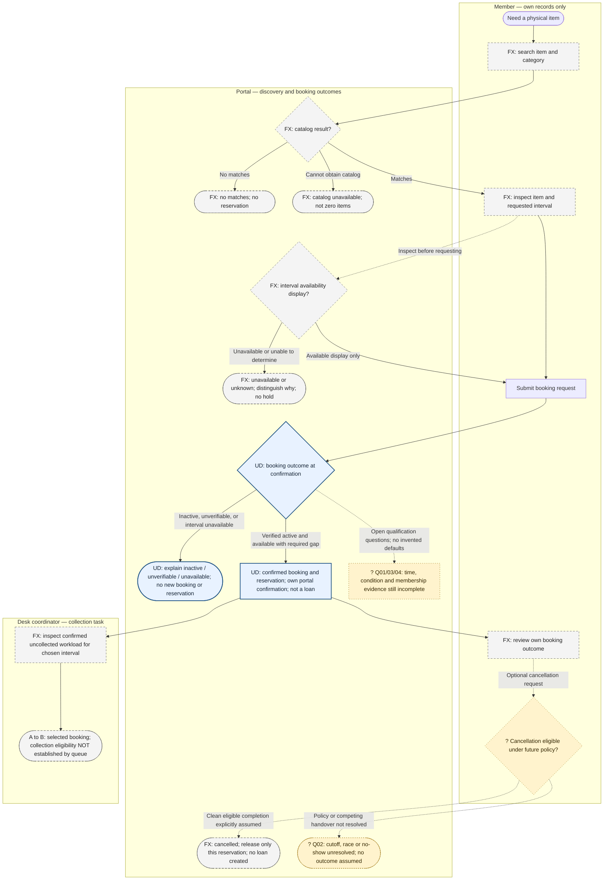
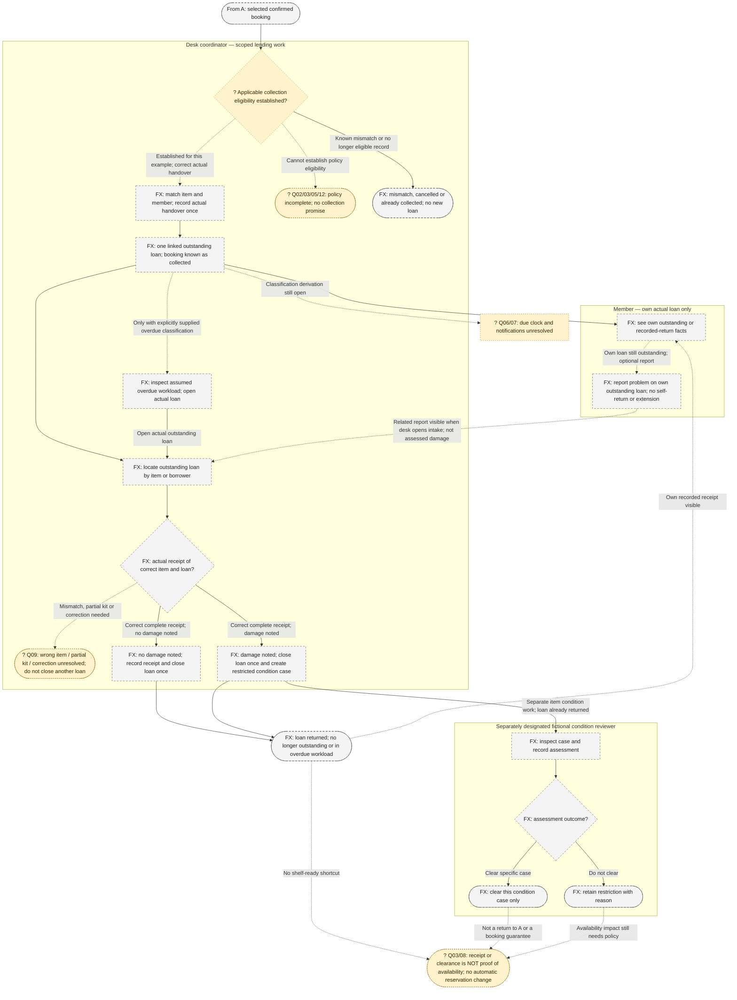

# KitDesk Expansion 01 — Lending lifecycle

**Provisional future-state process map · version 1 · 2026-10-17**

Find an individual item, reserve it, record what actually leaves the desk, and distinguish its return from its condition assessment. This is an **authored portfolio model**, not an implemented workflow, observed practice or stakeholder-validated process. The completed Expansion 01 sources are synthetic; their later scenario dates are narrative ordering, not approval dates.

## Read the journey first

1. **A member finds the right physical item.** Search by name/item identifier and category, then check availability for a selected interval. No matches, catalog failure and unknown availability are different outcomes. Browsing does not reserve anything or disclose who else borrowed it. This discovery experience is a review-pending fixture premise, not part of the confirmed booking promise. [FX-R01/02; FX-SRC-02 M01–M02]
2. **The member requests a reservation, not a loan.** Under the user-confirmed booking outline, verified active membership and an available interval produce immediate portal confirmation and a reservation without staff approval, pending status or training checks. Same-item reservations cannot overlap and require **at least 30 minutes** between the earlier end and later start, in either request order; exactly 30 minutes is sufficient on gap grounds. Inactive membership, unverifiable membership and an unavailable interval each produce their own explanation and **no new booking or reservation**. There is no actual loan without handover. Time/DST and complete condition qualification remain open. [UD-01–UD-08; KD-ST-001 AC-01–AC-08]
3. **The member can review their own booking; cancellation is conditional.** The extension proposes own confirmed/cancelled/collected records, not access to anyone else's details. A clean cancellation example can release only that booking's reservation, but only under a future agreed eligibility policy. The cutoff, cancellation-versus-handover race and no-show consequences are not decided. No automatic cancellation or race winner appears here. [FX-R03–05; FX-Q02]
4. **Desk staff prepare collection, then record actual handover.** The collection workload is a task-scoped list for a chosen interval, not an approval queue or membership directory. A confirmed reservation does not by itself authorize collection: identity/proxy, timing, condition and checkout membership-recheck questions remain. In an explicitly established-eligible example, staff match the actual item/member and record the handover once, creating one linked outstanding loan. Members cannot self-handover. [FX-R06–08/20; FX-Q01/03/05/12]
5. **While the item is out, the member sees only their own loan.** A member problem report helps the desk but is neither a return nor assessed damage, and does not pause or extend the obligation. Staff can locate an outstanding loan by item/borrower without waiting for it to become overdue. An overdue view is separately demonstrable only with an explicitly assumed classification; no clock, threshold or reminder delivery has been agreed. [FX-R09/10/16–19; FX-Q06/07/13]
6. **Desk staff record what physically comes back.** Correct-item routine receipt closes the actual loan once, with no damage noted; it does not certify safety or make the item automatically bookable. Correct-item damaged receipt also closes the loan, but adds a condition case and restriction pending review. The returned loan is no longer in an outstanding-overdue workload even if assessment remains open. Wrong-item, partial-kit and correction paths stop at an unresolved decision rather than closing another loan. Members cannot self-return. [FX-R08/11–13/16/19; FX-Q03/09]
7. **A separately designated fictional reviewer assesses the condition case.** The reviewer may clear that specific case or retain its restriction with a reason. Ordinary desk/manager titles do not grant clearance. Neither receipt nor clearance automatically restores availability, fulfils the 30-minute separation, changes another reservation, creates a debt or reopens the loan. Actual clearance authority/evidence and condition-to-availability rules still need decisions. [FX-R14/15/22; FX-Q03/08]

## How to read the maps

- **UD — solid blue node:** user-confirmed booking behavior, conditional on its stated prerequisites. This is not implementation evidence.
- **FX — dashed grey node:** authored synthetic premise, **review pending**. Connecting arrows describe the proposed journey, not approval or readiness.
- **? — dashed amber node / dotted link:** unresolved decision, conditional illustration or boundary that must not be treated as a settled rule. A branch labelled “example” requires an explicitly supplied setup; it is not an implicit default.
- Lanes identify the person using a capability or the portal communicating an outcome, not technical components, exact UI/API/database states or a production permission model. Outcome words such as “returned” are business concepts, not prescribed status strings.
- **A→B** is a handoff between diagrams, not evidence that finishing a predecessor makes the next action ready. Read the evidence table for failure/stale/uncertain paths kept out of the main visual spine.

## A — From discovery to a confirmed reservation

The direct selection-to-request route preserves KD-ST-001's independent scope; the display is **not** an extra booking approval gate. A previously available display does not guarantee availability at confirmation. AGate summarizes supported outcomes, not a mandated order of membership/availability checks. The 30-minute rule and simultaneous-conflict constraint apply there; no winning request order is specified. See trace rows A1–A5.

## B — From collection to actual loan, receipt and condition outcome

BView is a read view, not a loop that reopens a returned loan. Its reporting branch is available only while the own loan is outstanding. BReport adds information to desk work; it does not make return intake mandatory or create a condition case before receipt. BAssess/BChoice are conditional fixture behavior: real authority, clearance evidence and reversal rules are still FX-Q08. Overdue follow-up uses the actual loan, not a new possession record for the next reservation.

## Transition evidence and alternate paths

All FX references below inherit **author-defined fixture premise; review pending**. Linked source headings are the concrete evidence; the [pack register](../../sources/expansion-01/README.md#synthetic-premise-register) supplies compact premise definitions. Rows cover branch details deliberately omitted from the diagrams to keep the journey readable.

| Ref / nodes | Supported transition, ownership and alternate outcome | Source / authority |
|---|---|---|
| A1 · AFind–AInterval | Member selects an individually lendable item, not an interchangeable category. No matches differs from retrieval failure; interval unavailable differs from unknown. No hold from browsing; no borrower identities in catalog/availability. Time, condition and accessible interaction gaps remain Q01/03/11. | FX-R01/02; [FX-SRC-02 M01–M02](../../sources/expansion-01/02-member-staff-interviews.md#m01--finding-the-right-physical-item); [FX-SRC-05 D01](../../sources/expansion-01/05-text-design-revision.md#d01--equipment-discovery-and-item-view) |
| A2 · ASubmit–AConfirmed | Portal confirms without approval/pending; reservation belongs to the requested item/interval, not to a loan. Active membership suffices for membership/training eligibility; no training gate. No overlap; gap at least 30 minutes, exactly 30 included, regardless of request order. | UD-01–UD-06; [KD-ST-001 AC-01/02](../stories/KD-ST-001-book-available-equipment.md#acceptance-criteria) |
| A3 · AGate–AFail | Inactive: explain active membership required. Unverifiable: explain unable to verify, not “inactive”. Unavailable: explain interval unavailable and preserve existing reservations. Each creates no new confirmed booking/reservation; consequently none creates a loan. Concurrent confirmations must still satisfy the separation; no tie-break chosen. Members receive no other borrower's name/contact data. | UD-07/08; KD-ST-001 AC-03/04/06/07/08; [FX-SRC-07 I01–I04](../../sources/expansion-01/07-membership-readiness-brief.md#i01--what-is-already-settled-at-booking) |
| A4 · AOwn | Member can read own confirmation only (UD). Fixture listing extends that to known confirmed/cancelled/collected outcomes and linked loan; empty differs from unavailable. Deny another member's detail outright, not merely its attribution as “yours”, including changed references. No no-show expiry. | KD-ST-001 AC-05; FX-R03; [FX-SRC-02 M03](../../sources/expansion-01/02-member-staff-interviews.md#m03--my-bookings-and-the-missed-collection); [FX-SRC-05 D02](../../sources/expansion-01/05-text-design-revision.md#d02--own-bookings) |
| A5 · ACancel–ACancelled/ACancelStop | Only an own confirmed, uncollected booking is a candidate, with eligibility conditional on future policy. Clean completed cancellation releases only its reservation; no loan/other reservation changes or new-booking guarantee. Refusal is not success; repeated completed cancellation releases nothing else. A collected booking cannot be cancelled through this interaction. Concurrent handover/cancellation and no-shows remain unresolved, not first-click-wins. | FX-R04/05/21; FX-C02/Q02; [FX-SRC-04 P01–P03](../../sources/expansion-01/04-policy-options-conflicts.md#p01--cancellation-options-not-a-chosen-cutoff); [FX-SRC-06 X01](../../sources/expansion-01/06-staged-exception-observations.md#x01--cancellation-meets-collection-preparation) |
| A6 · AQueue–BEligible | Desk workload: confirmed, not yet collected, chosen interval; empty differs from unavailable. Cancelled/collected rows cannot authorize handover; stale rows need current-state explanation. Member has no queue/contact access. Staff contact scope is operational, not a directory; Q01/10 remain. | FX-R06/20; [FX-SRC-03 O01](../../sources/expansion-01/03-lending-operations-workshop.md#o01--preparing-collections); [FX-SRC-05 D03](../../sources/expansion-01/05-text-design-revision.md#d03--collection-workspace) |
| B1 · BEligible–BLoan/BStop/BNoLoan | Once eligibility is explicitly established and actual correct-item/member handover occurs, staff create one linked loan and booking becomes known as collected. Wrong item, cancelled or already collected: no new loan. Repeat/concurrent coordinators cannot create a second loan; no winner mechanism. Members cannot hand over; staff cannot substitute/override. Booking membership verification does not settle checkout recheck/failure policy or physical eligibility. | FX-R07/08/20; FX-C04/Q03/05/12; [FX-SRC-03 O02](../../sources/expansion-01/03-lending-operations-workshop.md#o02--actual-handover-is-a-separate-event); [FX-SRC-06 X02](../../sources/expansion-01/06-staged-exception-observations.md#x02--two-coordinators-and-one-physical-collection); [FX-SRC-07 I03](../../sources/expansion-01/07-membership-readiness-brief.md#i03--booking-and-collection-are-different-policy-points) |
| B2 · BView/BReport | Member sees only own actual loan and recorded receipt, not internal assessment or other borrowers' details. Due obligation shown only when established. Own-outstanding-loan report remains a report, visible to related desk work; returned loan rejects this reporting interaction. No closure, extension, fault finding, automatic case or monitored-response promise. | FX-R09/18/19; Q06/10/13; [FX-SRC-02 M04](../../sources/expansion-01/02-member-staff-interviews.md#m04--my-loan-and-a-problem-during-use); [FX-SRC-08 C04](../../sources/expansion-01/08-condition-return-workshop.md#c04--member-report-before-return); [FX-SRC-05 D04](../../sources/expansion-01/05-text-design-revision.md#d04--own-loans-and-member-problem-report) |
| B3 · BLookup–BReceipt | Desk locates outstanding loans by item/borrower for lending work, not all bookings, a membership directory or unrelated returned history. No-match differs from lookup failure; neither records a return. A non-overdue loan remains findable. Correct physical receipt and actual outstanding loan are required for the supported return paths. | FX-R10/11/20; [FX-SRC-03 O03–O04](../../sources/expansion-01/03-lending-operations-workshop.md#o03--finding-the-actual-loan); [FX-SRC-05 D05](../../sources/expansion-01/05-text-design-revision.md#d05--desk-loan-lookup-and-return-intake) |
| B4 · BRoutine/BWrong/BReturned | Staff record correct-item receipt and close loan once; stale/repeated attempt shows known current outcome, not a second return. Mismatched item cannot close another loan; partial kit/corrections remain Q09. No damage noted does not certify safety or availability. Requested booking interval is not rewritten by early/late receipt. No member self-return. | FX-R08/11/12; FX-C03/Q03/09; [FX-SRC-03 O04](../../sources/expansion-01/03-lending-operations-workshop.md#o04--routine-return-without-a-bookability-shortcut); [FX-SRC-06 X04/X06](../../sources/expansion-01/06-staged-exception-observations.md#x04--return-received-while-damage-remains-open) |
| B5 · BDamage–BAssess | Correct-item damaged receipt closes actual loan and creates related restricted condition case with staff observation, without duplicate receipt/case on repetition. Member report is not verified damage or proof of cause. No debt, membership change or silent reservation cancellation. Restriction's booking/collection effects remain Q03. | FX-R13/19/21; [FX-SRC-08 C01](../../sources/expansion-01/08-condition-return-workshop.md#c01--return-receipt-and-condition-are-different-facts); [FX-SRC-06 X04](../../sources/expansion-01/06-staged-exception-observations.md#x04--return-received-while-damage-remains-open) |
| B6 · BAssess–BClear/BRetain/BAvailability | Only separately designated fictional reviewer inspects relevant case/receipt context and assesses. Clear that case or retain restriction with reason. Ordinary desk clearance denied with case unchanged; already-cleared case shows current facts, not repeat clearance. No unrelated cases cleared, loan reopened or universal availability/safety asserted. Actual authority/evidence/reversals open. | FX-R14/15/20; FX-C06/Q03/08/10; [FX-SRC-08 C02–C03](../../sources/expansion-01/08-condition-return-workshop.md#c02--who-reviews-the-condition-case); [FX-SRC-05 D06](../../sources/expansion-01/05-text-design-revision.md#d06--condition-review-workspace) |
| B7 · BClock/BOverdue/BReturned | Only explicitly assumed overdue classification supports this desk-view example. Empty differs from unavailable classification. Returned loan leaves outstanding-overdue workload even with condition case open. Late loan does not extend itself, rewrite/cancel next reservation or select compensation/substitute. No member-wide list, email, export or escalation. | FX-R16/17/22; FX-C05/Q06/07; [FX-SRC-04 P04](../../sources/expansion-01/04-policy-options-conflicts.md#p04--overdue-is-not-an-agreed-clock); [FX-SRC-06 X03](../../sources/expansion-01/06-staged-exception-observations.md#x03--late-loan-and-the-next-reservation); [FX-SRC-05 D07](../../sources/expansion-01/05-text-design-revision.md#d07--overdue-workload) |
| All FX actions · interrupted/denied/stale paths | Known refusal/failure before completion leaves targeted record unchanged and claims no change. Uncertain completion asserts neither success nor unchanged record: reconcile selected record's known outcome before inviting potentially duplicating work. No timed retry, automatic recovery or transport contract. Actor/record scope survives changed references and bypassed controls; no broad staff editing, cancellation, membership change or override permission follows. | FX-R20/21; [FX-SRC-03 O05](../../sources/expansion-01/03-lending-operations-workshop.md#o05--access-and-unsupported-exceptions); [FX-SRC-06 X05–X06](../../sources/expansion-01/06-staged-exception-observations.md#x05--interrupted-confirmation) |

## Decision gaps: what is blocked, what remains useful

“Blocked” below concerns a complete rule or readiness claim, **not** permission to execute an assumed scenario. Decision owners are fictional roles for a future user role-play, not actual assignments. All 14 questions remain open; see [FX-SRC-04 P05](../../sources/expansion-01/04-policy-options-conflicts.md#p05--question-register).

| Gap | Decision role / blocked action or claim | Supported partial journey |
|---|---|---|
| FX-Q01 · date/time, DST, ranges/durations, queue boundaries | Maya + Leon; time-zone owner unconfirmed. Blocks exhaustive booking and queue-time qualification. | Stated, agreed interval examples; preserve exact >=30-minute separation without inventing time defaults. |
| FX-Q02 · cancellation cutoff, race, no-show | Maya + Leon. Blocks deterministic cancellation/handover race, expiry or full cancellation eligibility. | Own booking review, conditional clean cancellation example, and conditional handover separately; never assume both competing actions succeed. |
| FX-Q03 · condition to booking/collection, inspection, future reservations | Maya. Blocks unconditional bookability, collection or post-clearance availability claims. | Conditional available-item booking; correct-item receipt and separate case facts. Do not narrow KD001 with invented extension restrictions. |
| FX-Q04 · membership source, mapping, identity, freshness | Aisha + Sam. Blocks real dependency readiness. | Assume verified active for a labelled example; retain confirmed inactive/unverifiable booking failures. A closed dependency ticket is not usable membership evidence. |
| FX-Q05 · checkout recheck/failure | Aisha + Maya. Blocks complete collection eligibility, not booking's settled failure rules. | Explicitly established-eligible handover example; no presumed mandatory recheck, waiver or override. |
| FX-Q06/07 · due obligation, overdue clock/DST/disputes; notifications | Maya + Leon / Leon + Aisha. Blocks overdue calculation and all delivery claims. | Outstanding-loan lookup without overdue; separately assumed classification for staff-view reasoning. No “morning” schedule or email implied. |
| FX-Q08 · actual clearance authority, evidence, reversals | Maya + Leon. Blocks real clearance permission and evidence criteria. | Separately designated fictional reviewer and clear/retain-case examples only. |
| FX-Q09 · wrong item, partial kit, disputes, corrections | Maya. Blocks those return/correction outcomes and definitive disputed-condition explanation. | Correct complete receipt; mismatch does not close another loan. No invented repair, liability or correction flow. |
| FX-Q10 · contact minimization, sensitive notes, retention | Aisha. Blocks exhaustive field/retention contracts. | Task/record-scoped desk/reviewer views and own-only member access; no unrestricted history or internal-note disclosure. |
| FX-Q11 · accessibility/devices/assistance | Leon; missing participants. Blocks usability/accessibility validation claims. | Plain-language conceptual path only, not verified interaction design. |
| FX-Q12 · walk-ins, proxies, substitutes, extensions, no-shows | Leon + Maya. Blocks assuming those capabilities or collection identity/timing defaults. | Correct booked-item/member handover under supplied eligibility. No automatic extension or alternative arrangement. |
| FX-Q13 · problem-report urgency, safety, response owner | Maya + Leon. Blocks monitored response, emergency/safety guidance or due-date pause. | Record own-outstanding-loan report and show related report to desk as unverified information. |
| FX-Q14 · outcomes, launch boundary | Leon + Maya. Blocks quantified benefit, accepted release cut or readiness claims. | Connected candidate journey for review, not a launch commitment. |

## Conflicts, boundaries and source inventory

- **FX-C01 — approval versus automatic booking:** UD precedence settles this scenario's booking flow. Historical [PROJECT.md](../../project-context/PROJECT.md#problem-and-desired-outcomes) approval language and old designs remain history, not an alternative staff-approval path.
- **FX-C02 / C04 / C05:** cancellation timing, checkout recheck and overdue/notification alternatives remain unchosen. More recent invented dialogue does not win.
- **FX-C03 / C06:** the author supplied separation of receipt from bookability and a fictional reviewer designation to support exercises. These are not stakeholder resolutions of condition policy or real clearance authority.
- Excluded: payments/fines, purchasing, multi-site transfers, recurring bookings and public self-registration. No approved waitlist, temporary hold, email, export, override, walk-in, substitution, proxy collection or loan extension is smuggled into a diagram or promised for later delivery. No repair/certification process is authored here.
- Booking, actual possession and item condition remain separate business records/concepts. The 30-minute booking separation is not loan duration, cancellation cutoff, automatic inspection sign-off or damaged-item clearance.

| Evidence read | Version / purpose in this model |
|---|---|
| [Expansion pack README](../../sources/expansion-01/README.md) | v1; authority, 22 review-pending FX premises, 14 open questions, 6 conflicts and 13 candidate slices. These counts are source structure, not delivery commitments. |
| [FX-SRC-01 sponsor follow-up](../../sources/expansion-01/01-sponsor-follow-up.md#s01--why-another-discovery-round) | v1, S01–S05; purpose, reservation/loan/condition separation, exclusions and unagreed measures. |
| [FX-SRC-02 interviews](../../sources/expansion-01/02-member-staff-interviews.md) | v1, M01–M05; discovery, own bookings/loans, reports and missing perspectives. |
| [FX-SRC-03 operations](../../sources/expansion-01/03-lending-operations-workshop.md) | v1, O01–O05; desk collection, actual handover, loan lookup, routine receipt and scoped access. |
| [FX-SRC-04 policy memo](../../sources/expansion-01/04-policy-options-conflicts.md) | v1, P01–P06; cancellation, overdue, unresolved decisions and conflict handling. |
| [FX-SRC-05 text design](../../sources/expansion-01/05-text-design-revision.md) | v1, D01–D08; information needs and alternate states, not an inspected or approved UI. |
| [FX-SRC-06 staged observations](../../sources/expansion-01/06-staged-exception-observations.md) | v1, X01–X06; race, repeat, late return, damage, uncertainty and access reasoning; not test results. |
| [FX-SRC-07 membership brief](../../sources/expansion-01/07-membership-readiness-brief.md) | v1, I01–I05; booking versus checkout and absent usable dependency evidence. |
| [FX-SRC-08 condition workshop](../../sources/expansion-01/08-condition-return-workshop.md) | v1, C01–C05; damaged receipt, separately designated reviewer, assessment and report limits. |
| [FX-SRC-09 prioritization](../../sources/expansion-01/09-launch-prioritization.md#l03--candidate-sequencing-with-gates-intact) | v1, L01–L05; connected journeys and retained gates; suggested order is not mandatory sequencing or readiness. |
| [Initial UD decisions](../discovery/Discovery_Summary_KitDesk_20261016.md#user-role-play-decisions--2026-10-16) and [AC-trial UD decisions](../discovery/Booking_Decisions_AC_Trial_20261016.md) | 2026-10-16; actual user role-play decisions UD-01–UD-08, authoritative only to their stated scope. |
| [KD-ST-001](../stories/KD-ST-001-book-available-equipment.md) and [project context](../../project-context/PROJECT.md) | Booking v2 is unchanged canon with unresolved readiness limits; project v1 is historical context, not precedence over UD. No in-flight expansion backlog was used. |

## Validation and limitations

- **Manual inspection performed:** both Mermaid blocks' unique node IDs, declared edge endpoints, quoted labels, balanced delimiters/fences, closed subgraphs and labelled decision branches; path walkthrough from A start to B handoff and through conditional receipt/reviewer outcomes, with unresolved exits kept visible. The read-view/report loop is explicitly bounded to outstanding loans. Local linked files and cited heading/UD/AC/FX identifiers were checked against the supplied source text.
- **Not rendered or parser-validated.** No Mermaid renderer was used; actual layout and syntax acceptance in a particular viewer remain unverified. Manual readability review is not render proof.
- **Not executed or stakeholder validated.** No app, membership integration, real accounts, live operations, accessibility test, application test or approval is evidenced. No shell, install, remote write or credential use was performed.
- This map records conditional process relationships, not a ready-to-build state machine. Predecessor completion, a board label, fixture setup or document completeness cannot establish downstream eligibility, dependency availability, launch scope or acceptance. Canonical booking and source documents remain unchanged.
